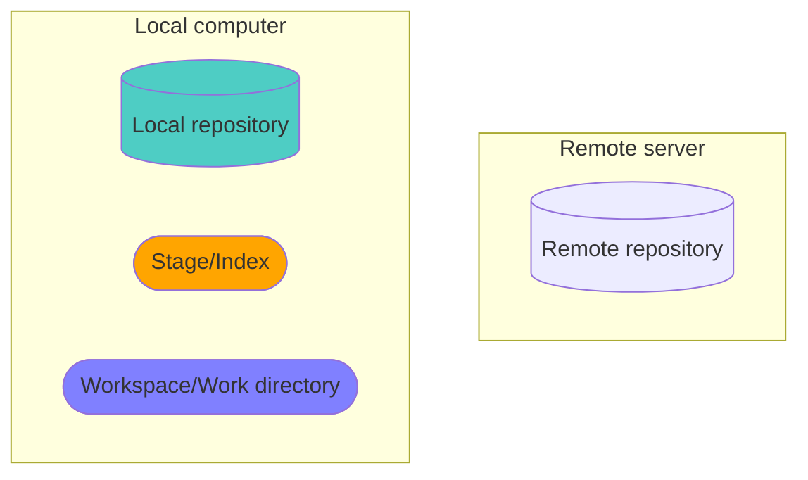
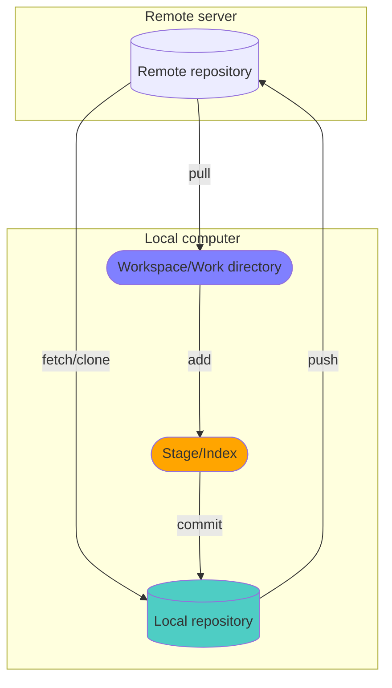

## Basic theory

Before learning Git, readers need to understand its structure, as the vast majority of Git commands used by users revolve around these structures:



There are three regions in the local computer:

* **Workspace/Work directory** - A directory for storing Git projects
* **Stage/Index** - A temporary storage area for project content changes, essentially a simple index file
* **Local repository** - Local storage area for all modified data

There is a region on the remote server:

* **Remote repository** - Refers to platforms that host code, such as Github, Gitlab, Gitee, etc.

You can easily understand the basic operations of Git through the following flowchart:



## Create or join a Git project

There are three ways:

1. **New project** - Create a new Git project with the owner being myself.
2. **Existing open source project** - Contribute to the project by performing a "Fork" operation or by becoming a member of the project team. At the end of the document, the meaning of "Fork" will be explained.
3. **Existing closed source project** - Become a member of the project team through invitation or other means. Each project member has one or more role permissions.

### Create a brand new Git project

Taking the Windows operating system as an example, suppose you need to create a **git-test** directory on drive E and initialize it as a Git project:

```
PS > cd E:\

PS > mkdir git-test

PS > cd .\git-test\

PS > git init
Initialized empty Git repository in E:/git-test/.git/

PS > ls -Force

    Directory: E:\git-test

Mode                 LastWriteTime         Length Name
----                 -------------         ------ ----
d--h-           2025/2/28    20:22                .git
```

Notes:

* "PS >" means using Windows Power Shell to execute commands
* After the Git project directory is successfully initialized, a **.git** hidden directory will be automatically generated

### Perform "Frok" operations on open source project

**Fork**: It refers to copying a copy of a project whose owner is yourself. After "Fork" is completed, you will own the ownership of this copy project. That is, under the condition of complying with the open-source license agreement, you can make any modifications without being restricted by permissions.

On Github, there is a "Fork" icon in the upper right corner of each open source project, click on it to copy a copy of the project to your remote repository.
