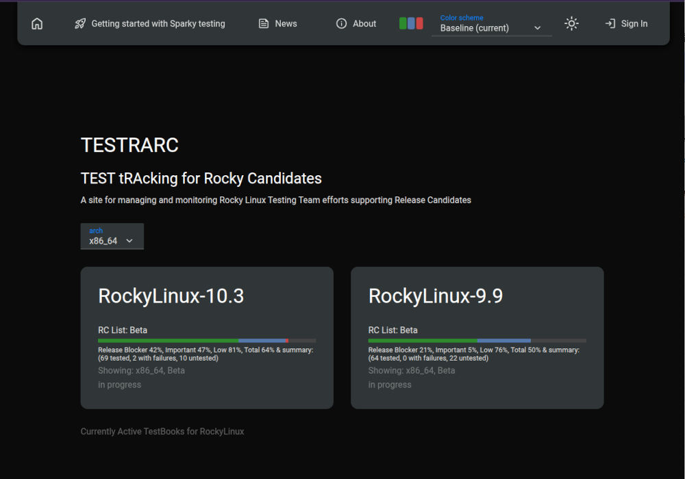
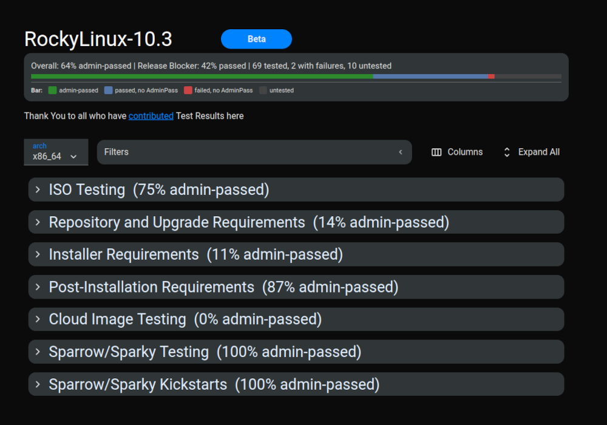
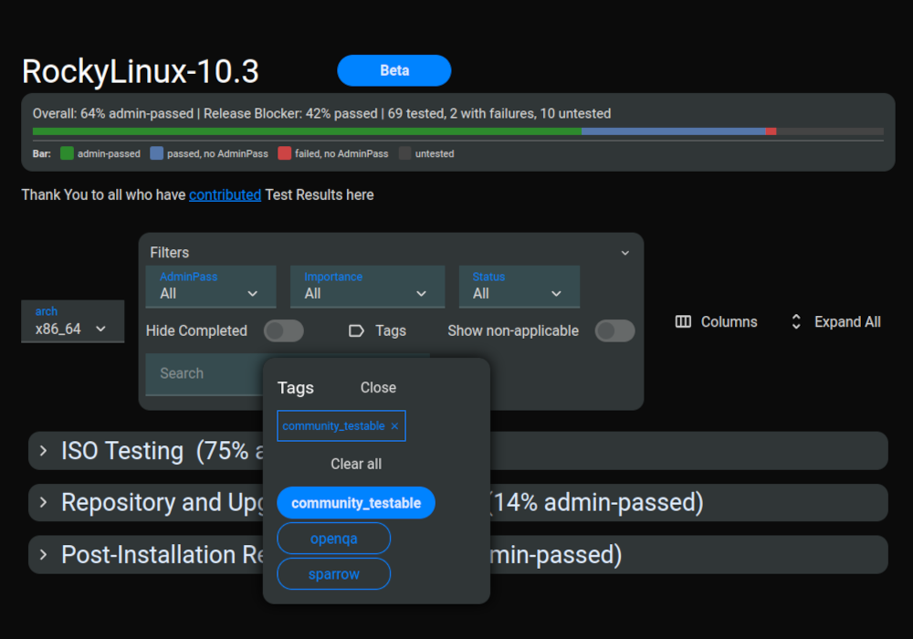
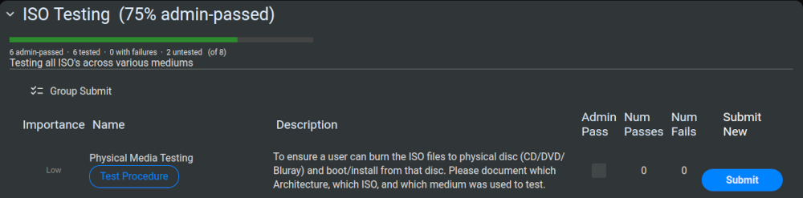
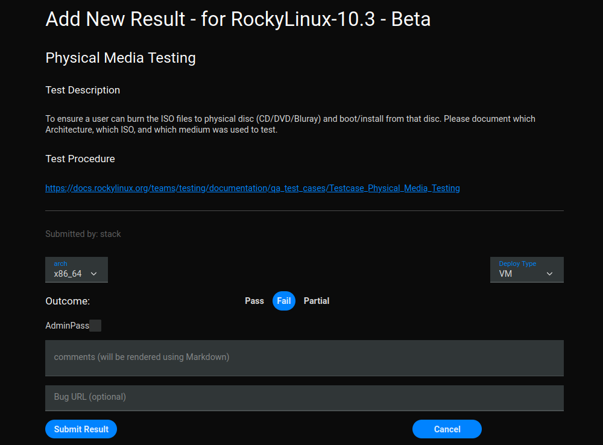

# Introduction

**TESTRARC** (**TEST** t**RA**cking for **R**ocky **C**andidates) is a dedicated, web-based platform tailored specifically to managing and monitoring the testing processes of Rocky Linux releases. The goal is to allow anyone to easily contribute to the testing of any Rocky Linux release and to publicly display the progress of each release.

- Code Repository: [https://git.resf.org/testing/testrarc](https://git.resf.org/testing/testrarc)
- Production Site: [https://testrarc.rockylinux.org/](https://testrarc.rockylinux.org/)

# Getting Started

The ability to view testing results and release status in the TESTRARC system is not restricted and all content is publicly available.

From the TESTRARC landing page the status of each active Testbook can be seen per architecture. Selecting a different "arch" will update the status for each Testbook.

> Note: The information for Testbooks without the arch may display incorrect information (ex: Rocky Linux 9 does not have riscv64 arch).

# Logging In

In order for a contributor to submit their own test results the must have a [Rocky Account Services (RAS)](https://accounts.rockylinux.org/) account. The RAS system manages accounts across Rocky Enterprise Software Foundation(RESF) and Rocky Linux managed systems. The process and requirements for obtaining a RAS account are **documented in the [Getting Started guide](https://docs.rockylinux.org/teams/infra/contribute/start/)**.

A contributor with a RAS account will be able to log in to [https://testrarc.rockylinux.org/](https://testrarc.rockylinux.org/) and submit results.

# Exploring Tests

## Terminology

**TestBook**
: A TestBook is a defined collection TestGroups, which in turn contain BasicTests which is affiliated with a specific Rocky Linux release. Testbooks will usually have multiple sub-releases such as BETA and RC-1 associated with them. Active Testbooks are displayed on the TESTRARC landing page in a tiled layout.

**TestGroup**
: A TestGroup is a collection of BasicTests with a generally common property. Sample TestGroups are: ISO Testing, Installer Requirements, Cloud Image Testing.
>NOTE: Throughout this documentation TestGroups may be referred to as Categories.

**BasicTest**
: A BasicTest is a single testable item that is part of a TestGroup. BasicTests have properties including: Name, Description, Importance, Tag(s), Applicable Arches, Applicable Releases and Testing Procedure links.
>NOTE: Throughout this documentation BasicTests may be referred to as Tests.

**TestResult**
: A TestResult identifies a single supplied result for a BasicTest. TestResults have properties including: Timestamp, User, Status, Deploy Type, Source, Comment, Bug and Test Result.
>NOTE: Throughout this document TestResults may be referred to as Results.

**Tag**
: A test may be labelled with one or more identifying tags which are/can be used to collect specific BasicTests for review/reporting easily using the Filtering capability which will be describe later in this document.

**Bare Metal**
: A bare metal test result is collected directly on a physical machine directly not in a container or VM instance on a physical machine.

**Container**
: A container test result can be collected with any common container technology like `docker`, `podman` or `apptainer`. The details of the container technology use may be useful to include in the test result `Comments` field.

**CloudVM**
: A cloud VM test result can be collected with any common cloud provider like `AWS`, `GCP` or `Azure`. The details of the cloud provider used and instance details may be useful to include in the test result `Comments` field.

**KVM**
: A KVM test result can be collected within a virtualized instance using `kvm` and/or `qemu`, possibly along with associated management tooling such as `libvirt`. The details of the KVM instance may be useful to include in the result `Comments` field.

**VM**
: A VM test result can be collected within any non-KVM virtualized instance, for example `vz` on macOS or `VirtualBox` on Linux/Windows, possibly along with associated management tooling such as `lima-vm`. The details of the VM instance may be useful to include in the result `Comments` field.

## Document Conventions

- UI operable elements are identified **`Like This`**.
- Test result data fields are identified `like this`.
- Test result data values are identified *`like this`*.

## Categories
Clicking on one of the Testbooks on the TESTRARC landing page will open to a view of all of the tests for the associated Rocky Linux release organized into their respective categories. By default, the display of the categories are expanded. The **`Collapse All`** option will collapse the categories to show only the category names along with summary completion statistics. Conversely, **`Expand All`** will expand all of the categories and show all the tests that are part of each category along with individual test completion statistics.

## Test Filters

To assist new contributors to find tests quickly a subset of tests are labelled with the `community_testable` tag. Click on **`Filters`**, then on **`Tags`**, and select **`community_testable`**. Finally, click **`Close`**. The resulting filtered list of tests should only include tests that have the **`community_testable`** tag applied to them.

The tests labelled with the **`community_testable`** tag are intended to be able to be completed by anyone without any special software or hardware tooling. Many of these tests require feedback from a wide variety of systems in different environments. Successes are just as important as failures!

All relevant contributions are helpful.

# Submitting the first test result

In this example, the first category is **`ISO Testing`**. It can be seen that 75% of this category has already been validated by an experienced Testing team member. However, it is very important to remember that a wide breadth of testing is helpful! Even if there are many submitted tests, your contribution is helpful!

The very first test is **`Physical Media Testing`**. The `Importance` is described as *`Low`* which means it will not block the release but it is desired to have someone test. Clicking **`Physical Media Testing`** will open a view of previously submitted test results. In this example, there are none. Clicking the **`Test Procedure`** will open the documentation for how to perform the test in a new browser tab/window. In this case, it is a simple document that directs the user to download the ISO and burn to a physical disc to be tested with a physical system. The `Description` is a summary of the test. There are currently no submitted test results so the `Admin Pass`, `Num Passes`, and `Num Fails` are all empty.

If the contributor is logged in, there should be a **`Submit`** button. If there is no **`Submit`** button, then please verify you are logged in.

Let's assume for this example that the ISO was downloaded, burned to a disc, booted, and verified. Click **`Submit`**. At the top is the heading, description, and a link to the test procedure.

- Select the architecture (`arch`) that the test was run on.
- Select `Pass`, `Fail`, or `Partial` as appropriate for this test result.
- Select the `Deploy Type` which for this case should be *`Bare Metal`*, but other tests could be *`KVM`*, *`Container`*, *`VM`*, or *`CloudVM`*.
- The `AdminPass` should only be available for those who contribute frequently. It's our hope that _you_ will one day have this option!
- Fill out the `Comments` in [Markdown](https://www.markdownguide.org/basic-syntax/) format. Please fill in relevant details on what environment you tested on, the results of the test, and anything else that may be relevant. This is particularly needed when testing other `Deploy Types` as it helps to know even greater details about the environment. Here details of tests considered to be *`Fail`* state may be most helpful especially if not enough is know to be able to create a Bug report.
- An optional `Bug URL` is very useful if you discover a problem and are able to file the bug with the relevant group. In some cases the appropriate location to file a bug might be the Rocky Linux [Bug Tracker](https://bugs.rockylinux.org/) while in other cases the appropriate location might be a reference to an upstream Bug Tracker if/when the issue has already been found to be reported upstream

Finally, **`Submit Result`** will save the results. You should be returned to the main TestBook page. Click on the **`Thank You`** link at the top to see your name mentioned!

# Next steps

After you've submitted a test, find another you are interested in helping. If you are not already on our [Mattermost Chat](https://chat.rockylinux.org) then join both the `~testing` channel and the relevant release channel.

Thank you for contributing!


